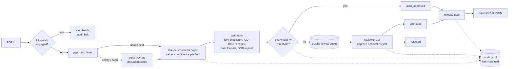

# intake-agent

A document intake pipeline for healthcare referrals and prior-authorization requests. It
reads a PDF, extracts twelve fields with Claude, scores each field, and only lets a record
go downstream after it clears a confidence gate or a human approves it. Every decision is
written to a hash-chained audit log, and a kill switch stops new extractions without
stopping review.

**Synthetic data only, no PHI.** Every patient, provider, member ID, NPI and payer in this
repo was generated by `intake_agent/synth.py`. NPIs are random numbers with a valid check
digit so the validators have something real to check; they are not looked up anywhere. Every
page carries a "SYNTHETIC TEST DOCUMENT" footer.

## Problem

Referral and prior-auth paperwork arrives as faxes, scans, payer forms and free-text letters.
Someone has to key the patient, member ID, ordering NPI, diagnosis and procedure codes,
requested service and urgency into a system before anything else can happen. An LLM can do
most of that typing. The hard part is knowing which outputs to trust: a wrong member ID or
CPT code that slides through silently costs more than a field a person had to look at.

So the design goal here is not "extract everything automatically". It is: extract
everything, send only the uncertain parts to a person, never let an unreviewed uncertain
value out, and be able to show afterwards who decided what.

## Architecture



| Module | Job |
|---|---|
| `synth.py` | Generates the labeled PDFs and ground-truth JSON |
| `pdftext.py` | pypdf text layer, rejoins glyph-per-line text, decides if text is usable |
| `extractor.py` | `ClaudeExtractor` (Messages API + pydantic schema) and `MockExtractor` (regex, no network) |
| `validators.py` | Normalizers and deterministic checks |
| `confidence.py` | Combines model confidence with validator results |
| `review_queue.py` | SQLite queue, reviewer decisions, the release gate |
| `audit.py` | Append-only JSONL with a hash chain |
| `killswitch.py` | Env var or file flag, checked before every document |
| `pipeline.py` | The batch loop |
| `eval.py` | Runs the pipeline on the labeled set and writes `results/eval-<date>.md` |
| `cli.py` | `intake` command |

## Quickstart

Needs Python 3.11 or newer.

```bash
python3 -m venv .venv && source .venv/bin/activate
pip install -e ".[dev]"

pytest -q                               # 49 tests, about a second
python -m intake_agent.eval --mock      # full pipeline + eval, no API key needed
```

Work the review queue by hand (state goes to `.intake/`):

```bash
intake run --mock                       # extract all 40 docs, gate, queue
intake queue list                       # what is waiting for a person
intake queue show doc-004               # each field, its confidence, and source text around flagged fields
intake queue correct doc-004 cpt_codes 45378 --reviewer alice
intake queue approve doc-005 --reviewer alice
intake queue reject doc-006 --reason "wrong patient" --reviewer alice
intake release                          # writes approved records to out/released/
intake audit verify                     # check the hash chain
intake audit tail -n 5

intake kill on --reason "bad deploy"    # new extractions stop; review and release still work
intake kill off
```

With an API key, drop `--mock`:

```bash
export ANTHROPIC_API_KEY=...
python -m intake_agent.eval             # writes results/eval-<date>.md
intake run
```

Settings come from the environment (see `.env.example`; `.env` is git-ignored and no key is needed for `--mock`): `INTAKE_MODEL` (default `claude-haiku-5-5`),
`INTAKE_EFFORT` (default `low`), `INTAKE_THRESHOLD` (default `0.85`), `INTAKE_STATE_DIR`
(default `.intake`), `INTAKE_KILL_SWITCH`, `INTAKE_REVIEWER`.

Regenerate the data set (deterministic for a given seed):

```bash
python -m intake_agent.synth --out data/synthetic --n 40 --seed 7
```

## Sample run

Mock mode, fresh state, reviewer name set with `INTAKE_REVIEWER=ops`. Output trimmed.

```text
$ intake run --mock
processed 40  auto-approved 12  queued 28  skipped 0  failed 0  cost $0.0000

$ intake queue list
doc        open fields  min conf
doc-002             12      0.00
doc-004              1      0.00
doc-005              2      0.00
...

$ intake queue show doc-004
doc-004  status=pending_review  model=mock-rules-v1  source=data/synthetic/doc-004.pdf
             patient_name        0.95  "Parker Templeman"
             member_id           0.95  "NWH441276794"
             referring_npi       0.95  "2759573829"
             icd10_codes         0.95  ["Z12.11", "Z80.0"]
[OPEN]       cpt_codes           0.00  []  (missing)
             requested_service   0.95  "Screening colonoscopy"
--- source near cpt_codes
    CPT/HCPCS
    DESCRIPTION OF SERVICE
    Screening colonoscopy

$ intake queue correct doc-004 cpt_codes 45378
doc-004: approved                      # last open field closed, so the doc is approved

$ intake release
released 13 documents to out/released  # 12 auto-approved + doc-004; the other 27 stay held

$ intake kill on --reason bad-deploy
$ intake run --mock
processed 0  auto-approved 0  queued 0  skipped 0  failed 0  cost $0.0000
HALTED by kill switch (... by ops: bad-deploy)

$ intake kill off
$ intake audit verify
ok: 98 records, chain intact

$ intake audit tail -n 2
{"seq": 97, "actor": "system:pipeline", "action": "halted_by_kill_switch", "doc_id": "doc-001", ...}
{"seq": 98, "actor": "ops", "action": "kill_switch_off", ...}
```

The approval gate is the release step: `release` only exports `auto_approved` or `approved`
records. Everything else, including any document with one unreviewed low-confidence field,
stays in the queue.

## The data set

40 PDFs in `data/synthetic/`, each with a `.json` ground truth. Five layouts:

| Template | Count | What makes it hard |
|---|---|---|
| `form_grid` | 10 | Clean clinic form, but names are printed `LAST, FIRST` and urgency is a checkbox row |
| `boxed_table` | 10 | Payer precert grid with different labels (Subscriber ID, Ordering NPI) and "Standard / Expedited" instead of routine / urgent |
| `letter` | 8 | Everything is in prose; dates are written out |
| `fax_handwritten` | 7 | Values drawn glyph by glyph with jitter, so pypdf returns one character per line |
| `scanned` | 5 | Image only, rotated, speckled, no text layer at all |

13 documents have one or two fields left blank, and one prints an NPI that fails the
checksum. Ground truth records what is on the page, so for a blank field the right answer
is "absent", and for the bad NPI the right answer is the printed value (the validator is
what should send it to a person).

## Eval results

**Only mock numbers exist so far.** No API key was available when this was built, so the
model has not been run against the set yet. The table below is from the rule-based
`MockExtractor`, which was written against these exact templates. It shows that the
pipeline, gate and eval work end to end; it says nothing about model quality.
Full report: [`results/eval-2026-11-10-mock.md`](results/eval-2026-11-10-mock.md).

| Metric (40 docs, threshold 0.85) | Mock, rule-based | claude-haiku-5-5 |
|---|---|---|
| Field precision (micro) | 100.0% | not run yet |
| Field recall (micro) | 87.9% | not run yet |
| Field accuracy (micro) | 88.3% | not run yet |
| Document exact match | 87.5% (35/40) | not run yet |
| Review-queue rate | 70.0% (28/40) | not run yet |
| Auto-approved docs with any wrong field | 0 | not run yet |
| Wrong fields caught by the gate | 56/56 | not run yet |
| Cost per document | $0 (no API calls) | not run yet |

How to read the mock row: it reads every text-layer document correctly and cannot read
the 5 scans at all, which is where every one of its 56 field errors comes from. All five
scans went to review, so nothing wrong was auto-approved. Its queue rate is high because it
reports a fixed 0.80 confidence on prose and 0.70 on fragmented handwriting text, which is
below the threshold by design.

Metric definitions: precision is correct non-empty predictions over non-empty predictions;
recall is correct non-empty predictions over fields present in ground truth; accuracy also
credits a correctly empty field. Code lists compare as sets; text compares case-insensitively
after normalization. Cost per document uses the token counts the API returns and the rates in
`config.py`.

## Design decisions

**Why a confidence threshold.** The point of the pipeline is to put a person's attention
where it is needed. A per-field score lets most documents through untouched and routes only
the uncertain fields. Model self-reported confidence alone is not calibrated, so it is
combined with deterministic checks: a value that fails a validator (bad NPI checksum,
malformed ICD-10 or CPT code, unparseable date, date of birth in the future) is capped at
0.30 no matter what the model says, and a missing required field scores 0. The threshold is
a single number (`INTAKE_THRESHOLD`) so it can be tuned against the eval: the two numbers
to trade off are the review-queue rate and "auto-approved docs with any wrong field".

**Why a human in the loop.** In this domain a wrong value is worse than a slow one. A
wrong member ID or CPT code on a prior auth turns into a denial or a delayed procedure. The
release gate (`ReviewQueue.release`) refuses anything that is not `auto_approved` or
`approved`, rejected documents can never be released, and a document only becomes
`approved` once every flagged field has been approved or corrected by a named reviewer.
The reviewer CLI shows each flagged field next to the source text it came from, so the check
takes seconds rather than a re-read of the whole document.

**Why an audit log.** When a downstream record is wrong, the first questions are which
model and prompt produced it, what the value was before a person touched it, and who
approved it. Every record in `audit.jsonl` has who, what, when, the model, a prompt hash,
and before/after values. The file is opened append-only and each record carries the hash of
the previous one, so an edited or deleted line breaks `intake audit verify`. That is
tamper-evident, not tamper-proof: someone with write access could rewrite the whole chain.
A production version would ship records to write-once storage.

**Why a kill switch that drains.** If extraction starts producing bad output (a model
change, a new fax template, a bad deploy), the safe move is to stop new extractions
immediately without throwing away work already queued. The switch is checked before every
document, not once per batch, so a running batch stops at the next document. Review,
approval and release keep working. It can be thrown from the environment
(`INTAKE_KILL_SWITCH=1`) or by an operator (`intake kill on`), and both are audited.

**Why text first, PDF second.** Sending extracted text is cheaper and easier to show a
reviewer. Only when pypdf finds no usable text (scans, image-only faxes) does the
extractor send the PDF itself as a document block. Glyph-per-line text from handwriting
fonts is rejoined before either path.

**Why structured output.** The extractor passes a pydantic model to `messages.parse`, so
the response is schema-valid JSON with a value and a confidence for every field. No regex
over model prose, no retry-on-parse-failure loop.

## Limitations

- The model path has not been run against the API yet (no key at build time). It is
  covered by tests that run the real SDK against a fake HTTP transport, which checks the
  request shape (model, structured-output schema, effort, text vs document block) and
  response handling, but not model behavior or whether the API accepts every parameter.
- The data set is small (40 docs) and generated by the same code that defines the ground
  truth. Real faxes are messier: multi-page packets, cover sheets, stamps, skewed handwriting.
- The mock extractor is fitted to these templates. Treat its numbers as a plumbing check.
- Text comparison is exact after normalization, so a model that paraphrases
  `requested_service` is scored wrong even when a human would accept it.
- Self-reported confidence is not calibrated. The next step is a calibration curve from
  real-model eval runs (confidence bucket vs observed accuracy) to set the threshold.
- No code-set lookup: ICD-10 and CPT are format-checked, not checked against the code
  tables, and NPIs are checksum-checked, not looked up in NPPES.
- Single-process SQLite and a local JSONL file. Fine for a demo, not for concurrent
  reviewers at volume.
- Reviewer identity is whatever name is passed on the command line; there is no auth.
- Tested on Python 3.14 on macOS only. The audit log uses `fcntl`, so it does not run on Windows.

## Layout

```
intake_agent/        package (see table above)
tests/               pytest: validators, queue + release gate, audit chain, kill switch, extractors, eval
data/synthetic/      40 PDFs + ground-truth JSON
results/             eval reports
```
